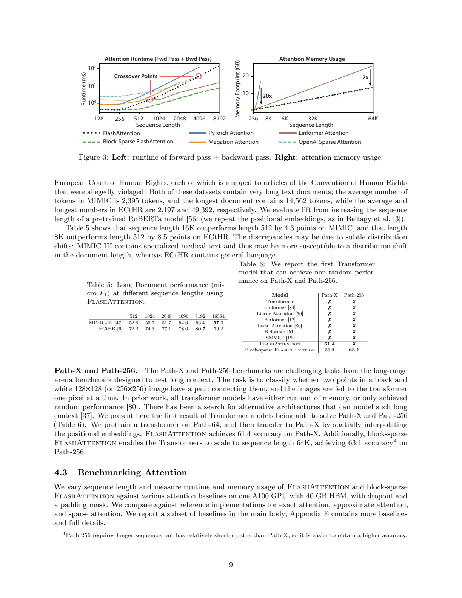

# 读论文时把"FLOPs 更少""IO 更少""更快"读混怎么办：《FlashAttention-2》Figure 2 与 Theorem 2 的一次真实核查

我在读《FlashAttention: Fast and Memory-Efficient Exact Attention with IO-Awareness》（Dao 等，arXiv:2205.14135v2，2022-06-24）时，连续踩到同一个坑：**这篇论文最反直觉的地方，是它把三个通常被认为同向的量拆开了。**

Table 2 和 Figure 2 里同时出现 FLOPs、HBM 读写量、墙钟运行时间。直觉上"算得更少 → 搬得更少 → 跑得更快"，但这篇论文的实际数据是：**FlashAttention 的 FLOPs 比标准注意力更多，却跑得快 5.71 倍。** 如果读的时候顺手把"FLOPs 更少"当成加速理由，结论整个就反了。

这次分享把这个阅读难点拆成 D1–D4 四道子题，用**一次真实的玻尔（Bohrium）调用**把论文页交给模型回答，再逐题回到原文核查。结果分三类：机械定位全部合法（15 段证据全在范围内）、科学结论基本正确、但模型在**两个地方**留下了需要作者补上的洞——一处是"没有出现质量下降"的表述过强，一处是它没能看到第 9 页 Figure 3 的交叉点（原输入本来就没有第 9 页，这是输入边界，不是模型过错）。

下面把论文原文、模型原答、我的推导和判断分开写。

---

## 一、阅读难点：三个量，两个方向

第 6 页 Figure 2 左图的表（`numbered.txt` 的 FA2-P6 行 1–4）只有三行：

| 量 | Standard attention | FlashAttention | 方向 |
|---|---:|---:|---|
| GFLOPs | 66.6 | 75.2 | **Flash 更多** |
| HBM R/W (GB) | 40.3 | 4.4 | Flash **少 9.16 倍** |
| Runtime (ms) | 41.7 | 7.3 | Flash **快 5.71 倍** |

三个量里，只有 FLOPs 和运行时间**不同向**。论文在 FA2-P6 行 53–56 明确写：

> "the number of HBM accesses is the main determining factor of attention run-time"；
> "even though FlashAttention has higher FLOP count compared to standard attention (due to recomputation in the backward pass), it has much fewer HBM accesses, resulting in much faster runtime."

也就是说：加速来自**少搬数据**，不是少算数。反向传播要重算中间结果，所以算得更多。

这就是本次实践要检验的核心：**模型会不会把"FLOPs 更少所以更快"当成结论？** 它会不会把"精确注意力"和"近似注意力"的标签安错到方法上？它会不会把 Proposition 3 的**下界**读成"处处最优"？

---

## 二、问题与方法（运行前冻结）

### 四个子题

- **D1**：读出 Figure 2 左表的三个数值，判断 FlashAttention 的 GFLOPs 是更高还是更低，并说明哪个量在决定运行时间。
- **D2**：写出 Theorem 2 的两个复杂度表达式、Proposition 3 的下界结论，以及论文给出"访问次数远少于标准实现"的条件。
- **D3**：FlashAttention 是精确还是近似？块稀疏 FlashAttention 呢？Table 2 的 ppl 与训练时间是多少？是否出现质量代价？
- **D4**：能/不能得出哪些结论？能否说"降低了时间复杂度"？能否说"近似注意力都没有墙钟加速"？能否把块稀疏的加速推广到所有序列长度？

### 方法

1. **只给证据页**。把 PDF 物理页 1 / 3 / 6 / 8 的文本按行编号成 `numbered.txt`（`FA2-P1` / `FA2-P3` / `FA2-P6` / `FA2-P8`），不提供第 9 页、第 7 页，也不提供任何问答示范。
2. **一次真实调用**。`bohr chat`，`--model gpt-5-mini --payment-source photon --output json`，无历史、无工具、180 秒超时。调用前用同命令 `--dry-run` 逐字核对 `data.operations[0].body.message`，并在 message 开头加一个独立非语义 nonce 防缓存。服务端 temperature / seed 不可锁定，这一点如实记录。
3. **双层验收**。机械层 `validate.py` 只查 JSON 合法性、题号、字段和行号范围；语义层由我逐题核对方向、单位、下界/上界、exact/approximate 标签和限定条件。**机械通过 ≠ 科学正确。**
4. **原答不改写**。模型答错的、说过头的，都原样保留；正确解答由我在 `audit.md` 给出，并明确标为作者核查。

冻结哈希见 `protocol-lock.json`（覆盖 `criteria.md`、`protocol.md`、`task.txt`、`sources.json`、`numbered.txt`）。运行前先校验哈希，材料被改动就直接中止。

### 关于 PDF 文本抽取（这一步本身就是个坑）

这份 PDF 的 Type-1 数学字体**两个抽取器都读错**：pypdf 把乘号映射成 U+0002、减号映射成 U+0000、逗号映射成 U+0096；更关键的是**上下标被拆到独立行并降级成普通数字**，于是 `Θ(N²d²M⁻¹)` 直接变成 `Θ(N 2d2 M-1)`。如果直接把这种文本喂给模型，模型读到的是一个**本身就不自洽的公式**。

我的处理写在 `normalize_pdf_text.py` 里：保留 pypdf 的行切分（它至少把公式留在同一行），先用一个**显式字符替换表**修单字符错误，再用一个**按 (页码, 行号) 定位**的表格修 15 条公式。每一处都对着渲染出的原页图像核过（`page6.png` / `page8.png` / `page9.png`），脚本会报告"15 条修复全部命中"。这是**字符重编码**，不是实验；它不改动任何数值。

---

## 三、真实模型输入、输出与 metadata

| 项目 | 值 |
|---|---|
| 模型 | `chenkun/gpt-5-mini`（取自响应 `data.model`） |
| completion id | `chatcmpl-EdSs4uErIUsMzpO6LZxiyevhqxsnK` |
| usage | prompt 5455 / completion 3927（含 reasoning 1984）/ total 9382 tokens |
| 墙钟耗时 | 34.844 秒 |
| 费用 | **null** — 服务不逐次返回货币扣费，不能填 0，也不能用余额反推 |
| 历史 / 工具 | 无 |
| 温度 / 种子 | 服务端默认值，**不可锁定** |

- 完整输入：`request.txt`（= 独立 nonce + `task.txt` + `numbered.txt`）
- dry-run 预检：`preflight.json`
- 原始响应（余额已脱敏）：`response.json`
- **模型原始输出：`output.json`（本次是合法 JSON）**
- 机械校验结果：`validation.json`（`ranges_valid`，15 段证据，0 错误）
- 机器可读小结：`summary.json`

`stderr.txt` 记录 stderr（本次为 7 字节，即空标记）。

---

## 四、逐题核查

完整核查表在 [`audit.md`](audit.md)，这里给出结论。

### D1：三个量，两个方向 —— 模型原答正确

模型给出的数值是 **66.6 / 40.3 / 41.7** 与 **75.2 / 4.4 / 7.3**，并明确写出"FlashAttention 的 GFLOPs **更高**（75.2 > 66.6）"，以及"作者指出决定运行时间的主要量是 HBM 访问，而不是 FLOPs"。引用的三段证据（FA2-P6 行 1–4、26–29、53–56）逐行核对后都真正支撑该结论。

**这是本次最关键的一题，模型没有掉进"FLOPs 更少所以更快"的坑。**

### D2：Theorem 2 与 Proposition 3 —— 模型正确区分了"下界"和"最优"

模型写出标准注意力 `Θ(Nd + N²)`、FlashAttention `Θ(N²d²M⁻¹)`，正确写出 Proposition 3 是"不存在能在**所有** M ∈ [d, Nd] 上做到 o(N²d²M⁻¹) 的算法"，并主动指出"Proposition 3 说明不存在对所有 M 统一改善的算法，但论文也声称 FlashAttention 在一段 M 范围（typical SRAM 大小）内是最优/远优的"。

条件部分也写对了：典型 d 为 64–128、典型 SRAM M 约 100KB、`d² ≪ M`。

**我把这里标为"通过但有一个措辞需要收紧"**：模型写"论文也声称 FlashAttention 在一段 M 范围（typical SRAM 大小）内是最优/远优的"，把两件事混成一句。论文原话是"is optimal for a range of SRAM sizes"（FA2-P1 行 17–18），指的是**IO 访问次数**的最优；"远少于标准实现"来自另一句（行 35–36），依赖 `d² ≪ M` 的**具体取值**。两者的成立范围并不相同，合并表述会让人误以为"任何 SRAM 大小下都最优"。

### D3：exact / approximate 标签 —— 模型基本正确，但"没有质量下降"说得过满

模型答对了关键点：

- FlashAttention 是 **exact**（FA2-P1 行 15："an IO-aware exact attention algorithm"）；
- 块稀疏 FlashAttention 是 **approximate**（FA2-P1 行 18–19）；
- Table 2 数值全部正确：GPT-2 small 三家 ppl 都是 **18.2**，训练 9.5 / 4.7 / 2.7 天（1.0× / 2.0× / 3.5×）；GPT-2 medium 是 **14.2 / 14.3 / 14.3**，21.0 / 11.5 / 6.9 天（1.0× / 1.8× / 3.0×）。

**但有一处必须收紧**：模型写"表和正文指出没有出现模型质量下降——作者说明未改变模型定义且验证/训练曲线一致"。前半句过头了。

- "未改变模型定义、数值稳定、训练曲线一致"是**第 8 页首行**（FA2-P8 行 1–3）关于 **GPT-2 small** 的陈述；
- 而 Table 2 里 **GPT-2 medium 的 FlashAttention ppl 是 14.3，HuggingFace 是 14.2**——**FlashAttention 差 0.1**。

也就是说"same perplexity"对 small 成立，对 medium **不成立**。我在 `offline_calc.py` 里用训练天数重算了四个加速比（2.02× / 3.52× / 1.83× / 3.04×，与表中 2.0× / 3.5× / 1.8× / 3.0× 一致），并把 0.1 ppl 的差距单独打印出来。**这句话必须由作者改，模型原答保留。**

### D4：能/不能得出的结论 —— 模型答得稳，且诚实地标注了输入边界

模型的三个"不能"都答对了：

- **(a) 不能说降低了时间复杂度**。论文给的是 IO 复杂度 `Θ(N²d²M⁻¹)`，计算量仍是 `Θ(N²d)` 量级；模型的表述是"论文并未声称改变注意力的渐进计算复杂度（计算量仍与 N² 相关）"。正确。
- **(b) 不能说近似注意力都没有墙钟加速**。模型引用了 FA2-P3 行 16–21 的"many of them do not display wall-clock speedup"，并同时指出"在更长序列（>1K）一些近似方法（例如 Linformer）可能会变得更快"。正确。
- **(c) 不能推广到所有序列长度**。模型还引了 FA2-P6 行 58–60（块大小超过 256 后受算术瓶颈、再大就装不进 SRAM）。

**并且模型主动指出了一个我出题时的疏漏**：

> "所给页没有包含第 9 页 Figure 3 的具体细节（题中提到但未提供）"

这句话是对的，而且是对的——我确实没有把第 9 页放进输入。模型没有编造第 9 页的内容，而是如实报告边界。这是本次最让我信服的一个细节。

**作者的补充（第 9 页，原输入之外）**：我另外渲染了 `page9.png` 作为**作者侧补充**。Figure 3 左图标了 "Crossover Points"——FlashAttention 与 PyTorch Attention 的交叉点约在 **1024** 附近，与 Megatron 的交叉点约在 **512** 附近。也就是说，**序列长度超过这些点之后，标准注意力会追上甚至反超**。这恰好是 D4(c) 所问的边界，但它来自我事后补的第 9 页，**不是模型当时能看到的证据**，必须分开标注。



---

## 五、可复算的离线算例

[`offline_calc.py`](offline_calc.py) 是一个纯标准库脚本，读者可直接运行：

```
python offline_calc.py
```

实际运行输出保存在 [`offline-output.txt`](offline-output.txt)。它做四件事，且**每一行都标了来源类别**：

| 标记 | 含义 |
|---|---|
| **(P)** | 论文值，逐字转录自被引页（Figure 2 左表、Table 2、Theorem 2 / Proposition 3） |
| **(A)** | 由论文值算出的算术（比值、由训练天数反推加速比、ppl 差值） |
| **(T)** | 教学算例，参数是编造的（`N=1024, d=64, M=100000` 的公式演示；块稀疏与稀疏度成正比的示意表） |

脚本**没有**做的事也写在输出末尾：没有跑任何 GPU、没有跑 FlashAttention 内核、没有训练模型、没有做 NLI、没有产生任何新实验。

最值得看的一段是这个**方向性自检**：

```
FlashAttention GFLOPs ratio   = 75.2/66.6 = 1.129  (>1 => MORE flops)
HBM R/W reduction factor      = 40.3/4.4 = 9.16x fewer bytes moved
Runtime speedup               = 41.7/7.3 = 5.71x faster

Directionality check (A): flops grew by 1.129x, yet wall-clock improved by 5.71x.
=> The quantity that moved in the SAME direction as the runtime win
   is HBM traffic, not FLOPs.
```

这就是给读者的一句话检查卡：**看到"更快"，先问"哪个量跟它同向"。**

---

## 六、这次实践证明了什么、没证明什么

**证明了**：

1. 在这个任务上，模型能正确读出"FLOPs 更多但更快"这个反直觉关系，并给出逐行可核的证据（机械 15 段全合法，语义逐题核对通过 3 题、第 4 题有两处收紧）。
2. 模型能主动区分 Proposition 3 的**下界**与"在某范围内最优"，这是最容易读反的一处。
3. 模型在**输入缺失时诚实报告缺失**（第 9 页 Figure 3），没有编造。
4. "冻结输入 + 逐行编号 + 双层验收 + 逐题审计"这一套流程，对**语义型**论文问题也成立——不只是查行号。

**没有证明、也不能声称**：

- **没有对照**。本次只有一次调用、无 baseline 组，所以**不能**说"这种提示词/流程提高了答题质量"，也不报告任何稳定性、显著性或成本优势。
- **不是隐藏测试**。作者熟悉这篇论文，这是我为检验一个具体读数陷阱而设计的已知任务，不构成对模型阅读能力的普遍测量。
- **没有重新跑论文实验**。所有实验数值都来自论文本身；我的脚本只做算术。
- **没有 GPU 性能结论**。我未在 A100 上跑过任何 kernel，"快 5.71 倍"是论文表格里的数，不是我的实测。
- **服务端的 temperature / seed / 快照不可得**，因此本次结果不可精确复现，只能按同样的输入再跑一次看分布。
- **费用为 null**。服务不逐次返回货币扣费，我没有用余额去反推单次成本。

---

## 七、复做步骤

1. 取论文：`https://arxiv.org/abs/2205.14135v2`（CC-BY 4.0）。原 PDF 本地 SHA256 记录在 `SOURCES.md`，本包只含 4 页合法片段与 3 张页图，不重新分发整篇 PDF。
2. 重建证据文本：
   ```
   python normalize_pdf_text.py
   ```
   会打印字符修复命中数与残留控制字符数；`numbered.txt` 与 `sources.json` 随之重建。
3. 冻结输入：`protocol-lock.json` 记录 7 个文件的 SHA256。`run.py` 先校验哈希再调用。
4. 跑一次真实调用（需要本机 `bohr.exe`）：
   ```
   python run.py
   ```
   脚本会先 `--dry-run` 逐字核对 message，再发起真实请求，把 request / preflight / response / output / metadata 全部落盘。
5. 机械校验：
   ```
   python validate.py work/materials/sources.json work/runs/output.json
   ```
   退出码 0 表示 JSON 合法且行号范围全部存在。**这不表示语义正确。**
6. 离线算例：
   ```
   python offline_calc.py
   ```
7. 逐题语义核查：对照 `audit.md` 里的清单人工过一遍。

---

## 八、材料索引与来源

- **来源**：Tri Dao, Daniel Y. Fu, Stefano Ermon, Atri Rudraz, Christopher Ré. *FlashAttention: Fast and Memory-Efficient Exact Attention with IO-Awareness*. arXiv:2205.14135v2, 2022-06-24. https://arxiv.org/abs/2205.14135v2 。论文为 **CC-BY 4.0**。本包只含物理页 1 / 3 / 6 / 8 的逐行文本与物理页 6 / 8 / 9 的页图，均为合法片段，署名与许可保留在 `SOURCES.md`。
- **本包文件**（共 22 个）：

| 文件 | 内容 |
|---|---|
| `README.md` | 本正文 |
| `audit.md` | 逐题核查表（结论 / 论文原文 / 模型原答 / 作者推导 / 判定） |
| `SOURCES.md` | 论文版本、许可、原 PDF SHA256、抽取与修复说明 |
| `sources.json` / `numbered.txt` | 四页逐行编号原文（证据底本） |
| `page6.png` / `page8.png` / `page9.png` | 物理页 6 / 8 / 9 原页渲染（第 9 页为作者侧补充） |
| `task.txt` / `criteria.md` / `protocol.md` / `protocol-lock.json` | 真实问题、运行前标准、协议、冻结哈希 |
| `request.txt` / `preflight.json` / `response.json` / `output.json` / `metadata.json` / `stderr.txt` | 一次真实 Bohrium 调用的完整输入、预检、响应、原始输出、metadata |
| `validation.json` / `summary.json` | 机械校验结果与机器可读小结 |
| `validate.py` / `offline_calc.py` / `offline-output.txt` / `normalize_pdf_text.py` | 标准库脚本与真实运行输出 |

- **个人贡献**：把"FLOPs / IO / 墙钟"三量的方向性混淆拆成 D1–D4；重建并修复该 PDF 的数学字形抽取；设计并冻结证据底本与运行前标准；完成一次真实 Bohrium 调用；逐题语义审计并公开两处需要收紧的表述；给出可离线复算的算例与复做步骤。
- **披露**：本次核查由 Codex 辅助完成，作者本人（非盲）复核，**不是独立人类评审**，也不是对模型阅读能力的独立测量。
- 原创文字与脚本以 MIT 许可发布（见 `LICENSE`）；第三方论文片段保留原 CC-BY 4.0 许可。
